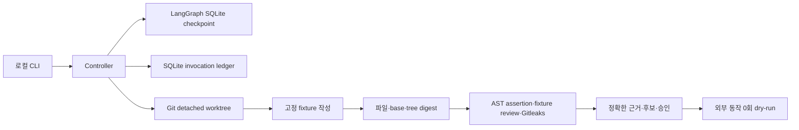

# 구조와 상태

이 버전은 하나의 로컬 사용자, 등록된 fixture writer와 정적 parser를 대상으로 합니다. 역할·provider·model·executor는 별개 필드입니다. registry의 enabled 상태와 실제 권한 검증이 실행 가능 여부를 결정합니다. worker 출력에 승인이나 정책을 넣어도 controller 권한으로 해석하지 않습니다.

## 실행 원장이 기준인 이유

LangGraph의 저장 위치는 다음 노드를 알려주지만 외부 효과의 시작 여부를 증명하지 않습니다. `RESERVED`를 트랜잭션으로 기록한 뒤 `STARTING`을 기록하고 효과를 수행합니다. 결과 receipt는 별도 트랜잭션으로 기록합니다. 원장과 체크포인트의 갱신이 원자적이라고 가정하지 않습니다.

| 재시작 시점 | 처리 |
|---|---|
| 예약 후 시작 전 | 같은 invocation ID로 진행 가능 |
| STARTING 기록 후 receipt 전 | NEEDS_RECONCILIATION, writer 소유권 유지 |
| receipt 후 checkpoint 전 | 원장 결과 재사용, 효과 재실행 없음 |
| 검사 후 checkpoint 전 | 같은 후보를 다시 대조하며 검사 가능 |
| 승인 interrupt | 부수 효과 없는 노드 재개, 승인 판단은 원장에서 수행 |

invocation ID는 task·step·attempt의 digest입니다. 중복 결과는 동일 receipt만 수용합니다. generation이 달라진 결과는 거부합니다. 호출은 작업별 총 3회로 더 보수적으로 제한하고, 동시에 활성인 호출도 최대 3개입니다. 기본 수리는 2회, 동일 실패 원인 3회째에는 차단합니다. 실제 fixture 리뷰는 모델 호출이 아니므로 호출 수에는 fixture 작성 단계만 포함합니다. 실제 팀 리뷰 예산과 병렬 작업은 후속 구현입니다.

## 후보와 승인

모든 tracked/untracked/ignored 파일의 bytes와 executable mode를 기록합니다. 변경 파일은 정확히 허용한 상대 경로와 대조합니다. 링크·submodule·특수 파일·대형 파일과 불안전한 경로는 거부합니다. 후보는 base/head/tree/변경 목록과 artifact digest를 묶습니다.

검사 중에는 worker가 실행되지 않습니다. 검사 뒤 후보를 다시 비교합니다. 승인은 후보, repo identity, base, 정책·계획 버전, generation, scope, 목적지·동작·인자, 전체 검사 근거와 finding을 묶습니다. 변경을 감지하면 승인 삭제와 BLOCKED 상태를 기록합니다. 만료·거절·근거 실패·누락·fixture scanner는 외부 gate를 통과하지 못합니다.

## 상태

`READY → RUNNING → VERIFYING → REVIEWING → REPAIRING` 또는 `READY_FOR_APPROVAL → COMPLETED`를 사용합니다. 필수 scanner 미확인은 `UNVERIFIED`, 실패는 `FAILED`, 범위 위반·수리 한도는 `BLOCKED`, 시작 불명은 `NEEDS_RECONCILIATION`입니다. 취소할 때 진행 중인 효과가 불명이라면 CANCELLED로 성공 처리하지 않습니다.

CLI와 로컬 stdio MCP는 같은 controller의 typed DAG를 실행합니다. step 결과와 명시적 result reference를 저장하고 writer는 직렬화하며 병렬 정적 검토는 고정된 후보 바이트를 읽습니다. 다음 항목은 미구현입니다: 임의 모델 분해, 실제 MCO/PAL 리뷰, 사용자 프로젝트의 임의 test/build 실행, 강제 복구, cleanup과 상태 UI입니다. MCP는 operator가 부여한 저장소에서 여섯 tool만 노출하며 승인·외부 작업을 제공하지 않습니다.

