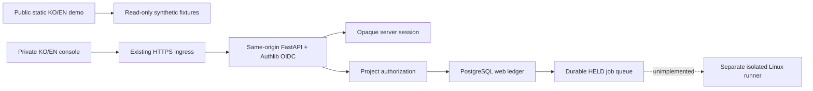

# Web boundary

The web console is separate from the local CLI/controller. It imports shared redaction and digest utilities, but never exposes the core repository allowlist, SQLite ledger, local locks, stdio MCP or provider dispatch over HTTP.

Public pages include introduction, documentation and eight sample screens. The standalone public build uses hash navigation and a CSP with `connect-src 'none'`. It cannot sign in, save work or call a backend. The private deployment notice collects no credentials. Its fixtures explicitly report zero model calls and unverified evidence.

The private console uses an existing operator-configured OIDC issuer with Authlib authorization-code flow, state, nonce and S256 PKCE. Issuer/subject must already map to an active operator-provisioned identity; login never creates users or projects. Session cookies contain an opaque random token, not user/role claims or provider credentials. Only a token hash and session state live in PostgreSQL. Login rotates the session, logout revokes it, and every request checks expiry and active identity. Sessions expire after one hour, without implicit sliding renewal.

Each project has a tenant identity and explicit member grants. Project, task, audit/log, artifact, connection and event snapshot reads are authorized independently. Unknown or inaccessible objects return 404. Operators submit/prepare/cancel; approvers approve/reject; owners manage existing member roles. A browser cannot enroll a new identity, change itself, select an actor/tenant, configure URLs/paths/credentials or enable execution.

Project row locks serialize mutations, permission changes and duplicate receipts on PostgreSQL. A request key is scoped to actor and project and bound to the payload digest. Reusing a key with a changed operation/payload returns 409. Receipts are historical mutation results; refresh reads current state. The service records task, held job, audit event and admission receipt in one database transaction. No in-memory queue or shared filesystem lock is used in production.

Admission creates `BLOCKED` tasks and `HELD` jobs. The API never starts a model, vendor CLI or arbitrary repository code. A held, unleased job can be confirmed never started and atomically cancelled. A leased/uncertain job becomes `CANCEL_REQUESTED`, retains its lease and cannot be recovered without trusted termination evidence. Preparing an unstarted recovery increments generation and clears candidate/evidence/approval. The future runner is explicitly unimplemented; its entry point fails closed.

Review grants bind candidate, policy, evidence, a fixed private-review destination, generation and expiry (at most 15 minutes). Before any possible dispatch, the service rechecks the grant, current candidate and approver membership inside the project transaction. Even a valid grant returns execution-disabled. There is no browser evidence ingestion or dispatch route. An external action policy and contained Linux runner need a separate implementation and authorization before enabling execution.

Artifacts are private text in the web database, returned only after project/task checks as `text/plain` attachments with `nosniff`. React renders candidate bytes as text. Audit detail is redacted before persistence; recognized secrets in task inputs are rejected before storing them. This regex defense does not replace a real secret scanner and cannot guarantee detection of all secrets.

SSE returns one bounded `snapshot` and closes. The browser reconnects at a five-second interval and must reauthorize each snapshot, so a long-lived authorized stream cannot continue after revocation. Audit/log reads are bounded to 100 rows, task lists to 100 and artifact metadata to 50. Pagination and a production runner are future work.

KO and EN share `web/src/i18n.tsx`. Initial selection is Korean for a Korean browser locale, otherwise English. Explicit selection overrides it and persists only the language in localStorage. The document language, date/number locale and resolved browser timezone stay aligned. IDs, code, model names, original diffs/logs and user-supplied project/task text are preserved. Fixtures receive localized display strings. Both builds use the same components and catalog.

Implementation references: [Authlib Starlette integration](https://docs.authlib.org/en/stable/oauth2/client/web/starlette.html), [SQLAlchemy locking](https://docs.sqlalchemy.org/en/20/core/selectable.html#sqlalchemy.sql.expression.GenerativeSelect.with_for_update), [FastAPI testing](https://fastapi.tiangolo.com/tutorial/testing/).
